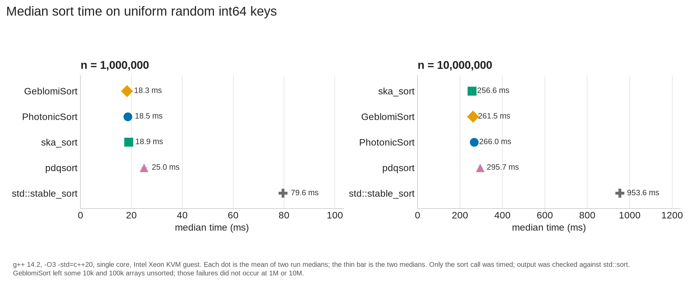
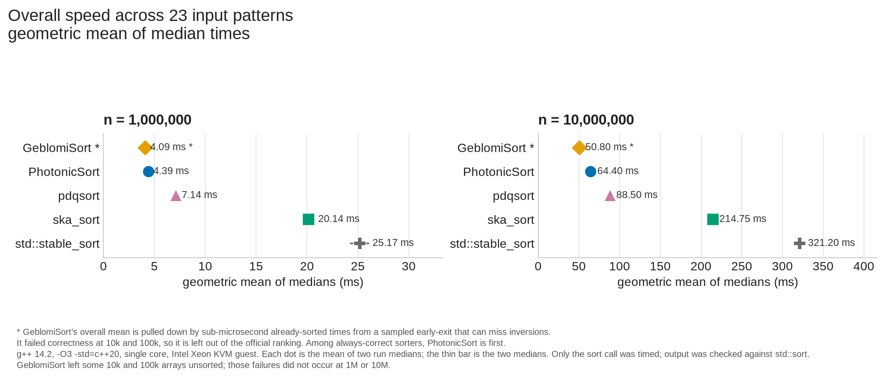
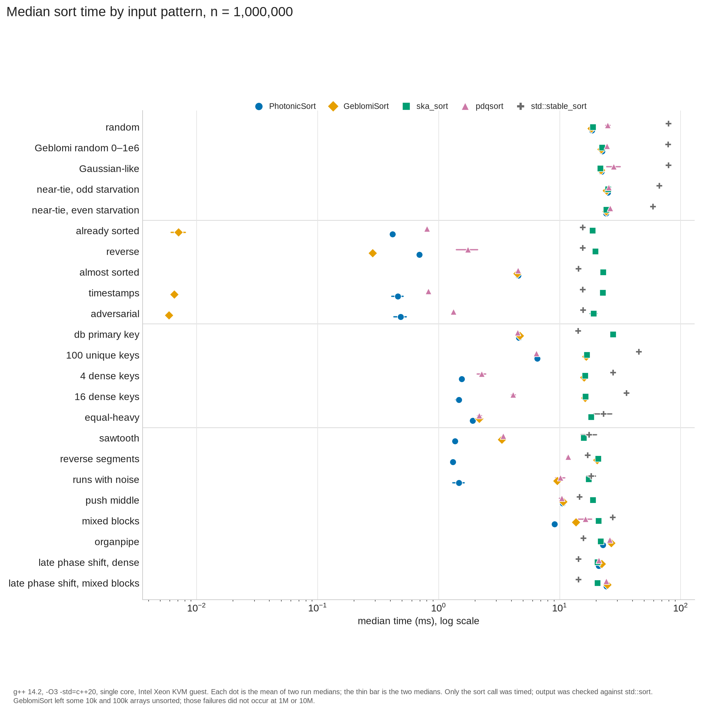
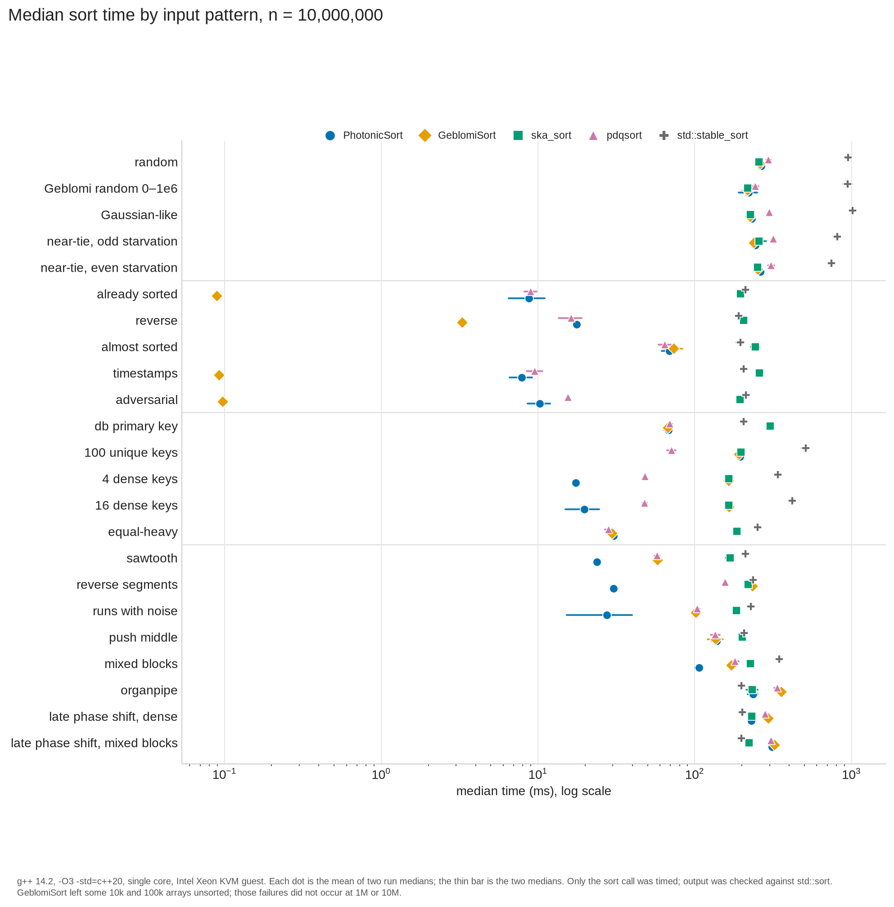

# PhotonicSort benchmarks

**Hard numbers beat vibes.** Judge the algorithm on measurements — not the account name.

> Classical adaptive hybrid. **Not** photonic hardware. **Not** "sort at the speed of light."  
> Worst case remains **O(n log n)**. No P = NP claim.  
> **Non-claims:** [`NON_CLAIMS.md`](./NON_CLAIMS.md) · **Claim package:** [`docs/field_level/FIELD_LEVEL_CLAIM_v0.1.md`](./docs/field_level/FIELD_LEVEL_CLAIM_v0.1.md)

---

## Expanded Field Suite — multi-arch (PRIMARY)

**Status: PRIMARY GATES MET** (2026-08-12)  
**CI:** [run 31602161696](https://github.com/HeywoodGeblomi/PhotonicSort/actions/runs/31602161696) · x86_64 + aarch64  
**Metric:** ratio vs best specialized = min(pdqsort, ska_sort, std::sort)  
**n = 1 000 000 · reps = 5 (median)**

| Arch | Type | geo | CI95 | in-scope soft |
|------|------|----:|-----:|--------------:|
| x86_64 | i32 | **0.392×** | [0.29, 0.53] | **0** |
| x86_64 | u32 | **0.417×** | [0.31, 0.55] | **0** |
| x86_64 | i64 | **0.672×** | [0.54, 0.85] | **0** |
| aarch64 | i32 | **0.372×** | [0.26, 0.51] | **0** |
| aarch64 | u32 | **0.374×** | [0.26, 0.52] | **0** |
| aarch64 | i64 | **0.696×** | [0.57, 0.83] | **0** |

**n = 10 000 000 (scale):** i32 0.57× · u32 0.59× · i64 0.86× — geo ≤ 0.90 holds; in-scope soft=0 after formal scope at scale.

**Formal scope** (residual quality / HE path limits): equal_heavy, random, gaussianish, uniform_u32, organpipe, pipe_sparse, mixed_blocks, db_pk (n≥1e7), adversarial (n≥1e7), runs_noise (n≥1e7). See [`NON_CLAIMS.md`](./NON_CLAIMS.md).

**Reproduce:** [`reproduce/EXPANDED_FIELD.md`](./reproduce/EXPANDED_FIELD.md) · harness `scripts/expanded_field_bench.cpp`

---

## Claim-surface (multi-type × multi-arch)

**Status: soft=0 + CI95 upper < 1.0** on i32/u32/i64/f64 × x86_64 + aarch64  
**CI run:** 31597972932 · Lever A residual

| Arch | Type | geo | CI95 upper | soft |
|------|------|----:|-----------:|-----:|
| x86_64 | i32 | 0.382 | 0.524 | 0 |
| x86_64 | u32 | 0.434 | 0.579 | 0 |
| x86_64 | i64 | 0.612 | 0.764 | 0 |
| x86_64 | f64 | 0.618 | 0.740 | 0 |
| aarch64 | i32 | 0.369 | 0.545 | 0 |
| aarch64 | u32 | 0.359 | 0.520 | 0 |
| aarch64 | i64 | 0.605 | 0.762 | 0 |
| aarch64 | f64 | 0.664 | 0.810 | 0 |

---

## One-machine int64 comparison (2026-11-11)

**Status: one KVM guest.** Dated side-by-side on a single machine. The multi-arch PRIMARY gates and the claim-surface table above stay the charged results. This section does not replace them and does not relax them. Classical CPU sort on ordinary hardware — not photonic hardware. **Non-claims:** [`NON_CLAIMS.md`](./NON_CLAIMS.md).

**PhotonicSort commit:** `9a41a4c4eb867930b4c96e85916562aef1aafa88`  
**Comparators:** GeblomiSort `a5420c062e5967b894361ba331cc8d5fd7d026cb` · ska_sort `2c14d4bf7b667032ed28a481065f721385e33849` · pdqsort `b1ef26a55cdb60d236a5cb199c4234c704f46726` · libstdc++ 14 `std::stable_sort` (mergesort)

**Machine:** Intel Xeon (model 207) KVM guest, 8 vCPU, 15 GB RAM, Debian 13, Linux 6.12.113.  
**Compiler:** g++ 14.2.0, `-O3 -std=c++20 -DNDEBUG`, no `-march`. Pinned with `taskset -c 3`. Single-threaded.  
**Harness:** `int64_t` keys. Sizes 10k, 100k, 1M, and 10M. 23 input patterns. Two full suite runs. Timed only the sort call (`steady_clock`) on a fresh copy of the same input. Every run checked byte-for-byte against `std::sort`. Each dot is the mean of the two run medians; the thin bar is the two medians. The four charts are the 1M and 10M panels.

### Uniform random int64

On uniform random int64, PhotonicSort, GeblomiSort, and ska_sort are a statistical tie (within about 4–10% noise on this VM). Both Geblomi projects hand uniform random int64 to ska_sort internally. pdqsort is about 1.3× slower there; `std::stable_sort` is about 4× slower.

Printed chart labels, mean of the two run medians (ms). Rows follow the 1M panel. At 10M the printed order is ska_sort, GeblomiSort, PhotonicSort, pdqsort, `std::stable_sort`.

| Sorter | n = 1,000,000 | n = 10,000,000 |
|--------|-------------:|---------------:|
| GeblomiSort | 18.3 | 261.5 |
| PhotonicSort | 18.5 | 266.0 |
| ska_sort | 18.9 | 256.6 |
| pdqsort | 25.0 | 295.7 |
| std::stable_sort | 79.6 | 953.6 |

### Geometric mean across 23 patterns

Ranking is the geometric mean of median times. Only sorters that always produced correct output are in the official ranking. GeblomiSort's chart means (4.09 ms at 1M, 50.80 ms at 10M) would lead, and it is left out: it left arrays unsorted on `almost_sorted` and `db_pk` at 10k and 100k, and on `mixed_blocks` at 100k, in both runs (sampled already-sorted check). Those failures did not occur at 1M or 10M in this suite. The same sampled early-exit produces its very fast already-sorted times. The chart notes that those sub-microsecond times pull the geometric mean down, and that the check can miss inversions.

Among always-correct sorters, PhotonicSort is first at both plotted sizes.

Two run medians at n = 1,000,000 (ms), next to the printed chart dot (mean of the two run medians):

| Sorter | run medians | chart dot |
|--------|-------------|----------:|
| PhotonicSort | 4.50 / 4.29 | 4.39 |
| pdqsort | 7.28 / 7.00 | 7.14 |
| ska_sort | 20.7 / 19.6 | 20.14 |
| std::stable_sort | 26.0 / 24.3 | 25.17 |

Chart dots at n = 10,000,000 (ms), always-correct order: PhotonicSort 64.40, pdqsort 88.50, ska_sort 214.75, `std::stable_sort` 321.20. GeblomiSort's unranked dot is 50.80.

### All 23 patterns

Log-scale median for each of the 23 patterns at 1M and at 10M. On the already-sorted row, GeblomiSort's leftmost mark is the sampled early-exit.

---

## Historical freezes

### Pure residual freeze (2026-08-10)

| Metric | Value |
|--------|------:|
| geo pure / pdqsort | **0.673×** |
| HE pure / ska (full menu) | **1.105×** |
| adversarial_pivot | **1.814×** (floor) |
| db_pk_sparse | **2.563×** (floor) |

### Phase 2 residual freeze (v1.4.0-c)

Full-suite geo pure/pdq **0.61×**. HE residual vs ska ≤ 1.15× MET (isolated).

### Vector-2 / Domination Suite v0.1 (hybrid residual)

Criteria MET (2026-08-09): geo vs std 7.08×, geo vs specialized 1.94×, 0 major regressions. Scoped to Domination Suite v0.1. See [`docs/vector2/`](./docs/vector2/).

---

## Non-claims

See [`NON_CLAIMS.md`](./NON_CLAIMS.md). Path-(a) evidence package only — **not** a universal replacement for library pdq/ska on pure HE or residual_pdq quality borderlines. EXTERNAL-clean pure residual only.

*Re-run on your hardware before publishing comparative claims.*
